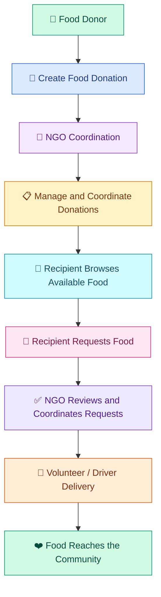

# 🌍 Community Food Sharing Surplus App

<div align="center">


### 🍃 Turning Surplus Food into Hope

**A mobile application connecting food donors, NGOs, recipients, and volunteer drivers to reduce food waste and support communities in need.**

[](https://flutter.dev/)
[](https://nodejs.org/)
[](https://expressjs.com/)
[](https://www.typescriptlang.org/)
[](https://www.prisma.io/)
[](https://cloudinary.com/)

[**Explore Repository**](https://github.com/VishwaNadeen/Community-Food-Sharing-Surplus-App) · [**Report an Issue**](https://github.com/VishwaNadeen/Community-Food-Sharing-Surplus-App/issues)

</div>

---

## 📖 About the Project

Food waste and food insecurity are significant challenges in many communities. At the same time, restaurants, businesses, and individuals may have surplus food that could help people in need.

The **Community Food Sharing Surplus App** is designed to bridge this gap through a digital food-sharing platform.

The application allows donors to share surplus food, NGOs to coordinate donations and distribution, recipients to discover and request available food, and volunteers to support delivery operations.

Our goal is to make food distribution more accessible, organized, and efficient while encouraging sustainable and community-driven food sharing.

## 🎯 Project Objectives

- 🌱 Reduce avoidable food waste.
- 🍱 Connect surplus food donors with people in need.
- 🤝 Support NGOs in coordinating food distribution.
- 🚚 Facilitate volunteer-based food delivery.
- 📱 Provide a convenient mobile platform for food sharing.
- ❤️ Encourage community participation and social responsibility.

## ✨ Key Features

<table>
<tr>
<td width="50%" valign="top">

### 🔐 Authentication & Profiles

- Role-based login
- User authentication
- Profile management
- Role-specific application access

</td>
<td width="50%" valign="top">

### 🍲 Donor Management

- Create food donations
- Manage donation information
- View donation-related activities
- Support food donation coordination

</td>
</tr>
<tr>
<td width="50%" valign="top">

### 🛒 Recipient Management

- Browse available food donations
- View food donation details
- Submit food requests
- Track personal food requests

</td>
<td width="50%" valign="top">

### 🚚 Volunteer & Driver Management

- Access delivery-related features
- Support food collection and distribution
- Manage volunteer delivery activities

</td>
</tr>
<tr>
<td width="50%" valign="top">

### 🏢 NGO Coordination

- NGO dashboard and administration
- Coordinate food requests and donations
- Support distribution management
- View impact-related information

</td>
<td width="50%" valign="top">

### ☁️ Media & API Integration

- Backend API integration
- Cloud-based image uploads
- Authentication middleware
- Data exchange between mobile and backend

</td>
</tr>
</table>

## 🔄 How the Application Works



*The diagram illustrates the overall collaboration between the application's main roles. Specific approval and delivery steps depend on the implemented workflow.*

## 👥 User Roles

| Role | Main Responsibilities |
|---|---|
| 🔐 Authentication | Secure login, role-based access, and user profiles |
| 🍲 Donor | Create and manage food donations |
| 🛒 Recipient | Browse donations and request food |
| 🚚 Volunteer / Driver | Support food delivery and distribution |
| 🏢 NGO Coordinator | Coordinate donations, requests, and distribution |

## 🛠️ Technology Stack

<div align="center">

| Technology | Purpose |
|---|---|
| [Flutter](https://flutter.dev/) | Cross-platform mobile application |
| [Dart](https://dart.dev/) | Mobile application programming language |
| [Node.js](https://nodejs.org/) | Backend runtime |
| [Express.js](https://expressjs.com/) | Backend API framework |
| [TypeScript](https://www.typescriptlang.org/) | Type-safe backend development |
| [Prisma](https://www.prisma.io/) | Database ORM |
| [Cloudinary](https://cloudinary.com/) | Image and media management |
| [Git & GitHub](https://github.com/) | Version control and team collaboration |

</div>

## 🏗️ Project Architecture

The project is organized into a mobile frontend and a backend API.

```text
Community-Food-Sharing-Surplus-App/
│
├── frontend/
│   └── lib/
│       ├── models/
│       ├── providers/
│       └── screens/
│           ├── auth/
│           ├── donor/
│           ├── ngo/
│           ├── recipient/
│           └── volunteer/
│
├── backend/
│   ├── src/
│   │   ├── config/
│   │   ├── controllers/
│   │   ├── middleware/
│   │   ├── routes/
│   │   ├── services/
│   │   └── app.ts
│   └── prisma/
│
├── README.md
├── CONTRIBUTING.md
└── .gitignore
```

*Note: This is a simplified architectural overview. Adjust folder names if your current repository structure differs.*

## 🚀 Getting Started

Follow these steps to run the application locally.

### Prerequisites

Install the following tools before starting:

- [Flutter SDK](https://docs.flutter.dev/get-started/install)
- [Dart SDK](https://dart.dev/get-dart)
- [Node.js](https://nodejs.org/)
- npm
- Git
- A configured database and the required environment variables
- Android Studio or another supported Flutter development environment

### 1. Clone the Repository

```bash
git clone https://github.com/VishwaNadeen/Community-Food-Sharing-Surplus-App.git

cd Community-Food-Sharing-Surplus-App
```

### 2. Set Up the Backend

```bash
cd backend
npm install
```

Create a `.env` file in the backend directory and configure the environment variables required by your backend, including database connectivity, authentication, and Cloudinary credentials.

Generate the Prisma client if required by your project configuration:

```bash
npx prisma generate
```

Start the development server:

```bash
npm run dev
```

*Database migrations or other database initialization steps may be required depending on your current Prisma configuration.*

### 3. Set Up the Flutter Application

Open a new terminal and navigate to the Flutter frontend directory.

```bash
cd frontend
flutter pub get
```

Check that a device or emulator is available:

```bash
flutter devices
```

Run the application:

```bash
flutter run
```

**Important:** Configure the mobile application's API base URL to point to your running backend. For an Android emulator, `10.0.2.2` typically refers to the host computer. A physical device generally needs the computer's reachable local network IP address.

## 🔒 Environment Configuration

Keep all secrets and credentials outside your source code.

Configure the appropriate environment variables for:

- Database connection
- Authentication and JWT
- Cloudinary media uploads
- Email services, if enabled

**Never commit your `.env` file, passwords, API secrets, or private credentials to GitHub.** Use a `.env.example` file containing placeholder values when documenting required configuration.

## 👨‍💻 Meet the Team

This project was developed collaboratively by four team members, with each member responsible for a specific part of the application.

<div align="center">

### 🌟 Our Development Team

</div>

<table>
<tr>
<th>Team Member</th>
<th>GitHub Username</th>
<th>Contribution</th>
</tr>
<tr>
<td><strong>Vishwa Nadeen</strong></td>
<td>HPVN Pathirana</td>
<td>Project setup, role-based login, authentication, login/profile functionality, and recipient module.</td>
</tr>
<tr>
<td><strong>Methma Sankalpani</strong></td>
<td>Sankaalpani GM</td>
<td>Volunteer and driver features, including delivery-related functionality.</td>
</tr>
<tr>
<td><strong>K. D. S. Nimesha</strong></td>
<td>K. D. S. Nimesha</td>
<td>Donor module and food donation features.</td>
</tr>
<tr>
<td><strong>S. P. T. Lakmini</strong></td>
<td>S. P. T. Lakmini</td>
<td>NGO module and NGO-related features.</td>
</tr>
</table>

We worked together to integrate our modules into a unified application and support the complete food-sharing process.

## 🌍 Social Impact

Our application aims to contribute to a more sustainable and supportive community.

- ♻️ **Sustainability:** Help reduce surplus food waste.
- ❤️ **Community Support:** Connect available food with people who need it.
- 🤝 **Collaboration:** Bring donors, NGOs, recipients, and volunteers together.
- 🚚 **Distribution:** Help coordinate food collection and delivery.
- 🌱 **Awareness:** Encourage responsible food-sharing practices.

## 🔮 Future Improvements

Potential enhancements for the application include:

- 🔔 Real-time notifications for donation and request updates.
- 📍 Improved location-based donation discovery.
- 🗺️ Enhanced delivery tracking and route planning.
- 📊 Expanded NGO impact analytics and reporting.
- ⭐ Donor and volunteer feedback systems.
- 🔐 Further authentication and security improvements.

These are proposed enhancements and are not necessarily implemented in the current version.

## 🤝 Contributing

Contributions, suggestions, and feedback are welcome.

1. Fork the repository.
2. Create a feature branch.
3. Make and test your changes.
4. Commit your changes with a meaningful message.
5. Submit a pull request.

Please read [CONTRIBUTING.md](CONTRIBUTING.md) for information about team responsibilities and contributions.

## 📸 Screenshots & Demonstration

Screenshots of the donor, recipient, NGO, login, and volunteer screens can be added here to showcase the actual application interface.

To include a screenshot stored in your repository, use:

```markdown

```

Replace the example path with the actual location of your screenshot. You can also add a link to a demonstration video once it is available.

## 📄 License

A license has not been specified in this README. If you plan to publish or distribute this project publicly, consider choosing an appropriate open-source license and adding a corresponding `LICENSE` file.

---

<div align="center">

### 💚 Share More. Waste Less. Care More.

**Every meal shared is a step toward a better community.**


**Built with care by the Community Food Sharing Surplus App team.**

[Back to Top](#-community-food-sharing-surplus-app)

</div>
